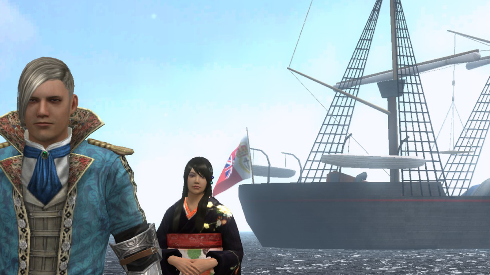
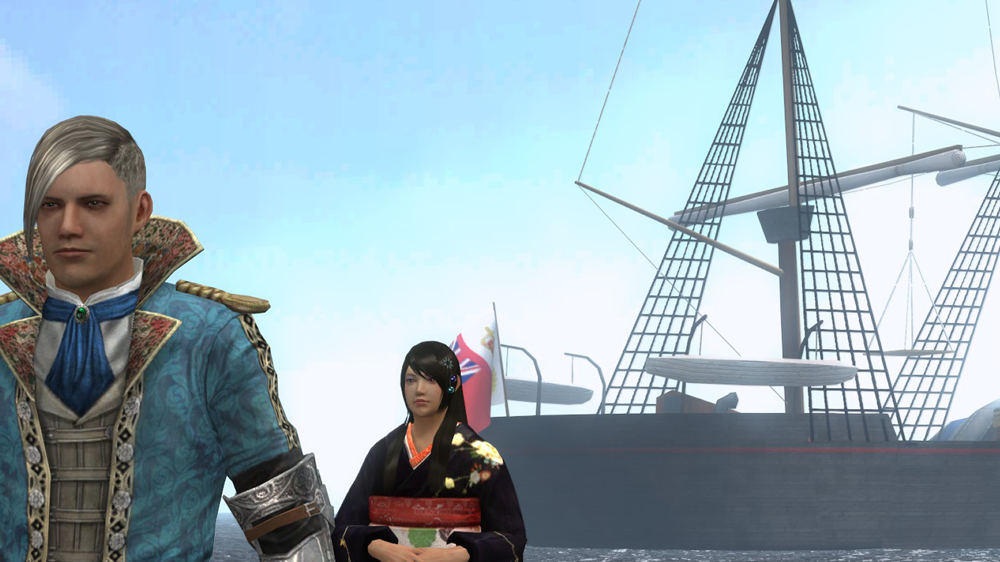
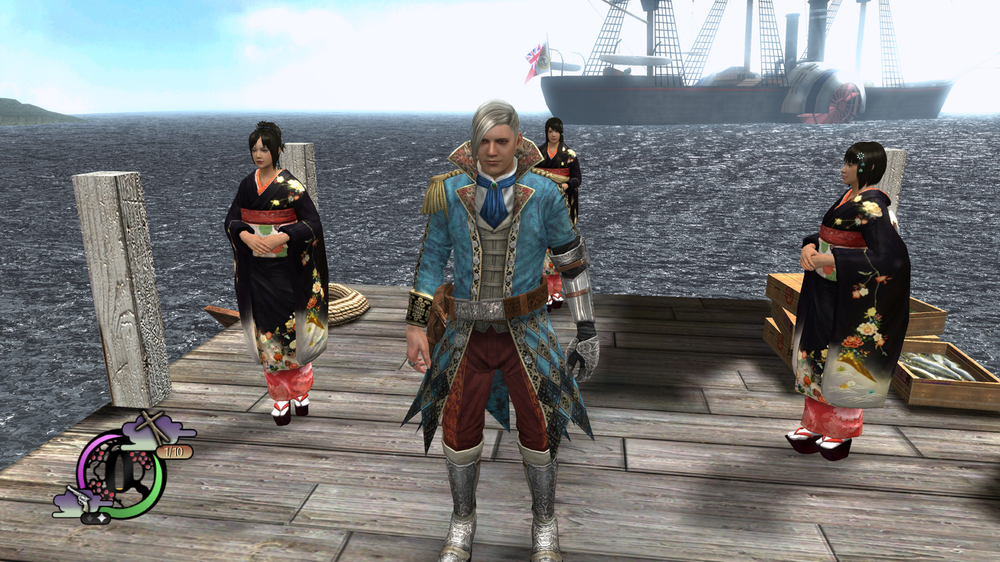
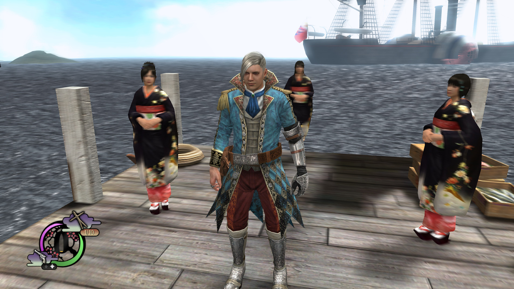

# Post FX

[日本語](README.md) | [Changelog](CHANGELOG.en.md)

> [!NOTE]
> This Mod is for the [Steam version of Way of the Samurai 4](https://store.steampowered.com/app/312780/4/?l=english) only.

Adds anti-aliasing, sharpening and camera motion blur to the 3D image. Text and the UI are not affected.

## Features

- FXAA reduces jagged edges. Fine patterns can become softer.
- SMAA 1x detects edge patterns and uses the official implementation's Ultra preset. It also uses depth differences, so it smooths the outlines of objects whose colors are close to the background.
- SSAA renders the 3D scene at a higher resolution and reduces it to smooth edges. Choose 2x per axis (4 samples per pixel) or 1.5x per axis (2.25 samples). 1.5x is lighter than 2x and its effect is milder. It can be combined with FXAA or SMAA. UI resolution stays unchanged.
- Sharpening uses AMD CAS (Contrast Adaptive Sharpening) to bring back detail softened by anti-aliasing. Areas that are already sharp are sharpened less.
- Anti-aliasing and sharpening apply before motion blur. They do not process the edges of blur streaks.
- Motion blur follows camera movement. It does not blur independently moving characters or swords while the camera is stationary.
- Blur strength and maximum width are reduced near the camera. This distance-based adjustment applies to the player, nearby NPCs and foreground objects.
- Enable each effect independently. The effects apply to the 3D image, not to text or the UI.
- Draws without usable camera or depth data skip motion blur; anti-aliasing remains independent.
- While the game window is minimized or in the background, only motion blur pauses; anti-aliasing and SSAA continue.
- After scene changes, camera changes, abrupt view changes, device recovery and similar interruptions, motion blur pauses briefly and then resumes.

## Comparison

### Anti-aliasing

Jagged edges on the ship's rigging and on the characters' outlines are reduced.

| Off | On |
| --- | --- |
|  |  |

### Motion blur

While the camera turns, the background and the people around blur along the motion. Blur on the protagonist in the foreground is reduced.

| Off | On |
| --- | --- |
|  |  |

## Settings

The Mod adds a "Post FX" tab ("映像後処理" in Japanese) to the title-screen and in-game options. Changes other than SSAA apply to the next draw. Save the options, exit the game and restart to apply SSAA changes. While SSAA differs from the setting in use, a notice below it says a restart is needed.

| Setting | Choices | Default |
| --- | --- | --- |
| Anti-Aliasing | Off / FXAA / SMAA | Off |
| Sharpening | Off / Low / Normal / High | Off |
| Motion Blur | Off / On | Off |
| Blur Strength | Low / Normal / High | Normal |
| Blur Quality | Low / Normal / High | Normal |
| SSAA | Off / 1.5x / 2x | Off |

Strength changes exposure, and quality changes the sample count (4 / 8 / 12). Higher quality increases GPU work. Actual rendering time and FPS have not been measured.

Stronger sharpening increases the light/dark contrast at edges. Too much of it can show outlines around edges.

SSAA multiplies the rendered pixel count by 4 (2x) or 2.25 (1.5x) and significantly increases GPU work and memory usage. If the enlarged scene exceeds device texture dimensions or the 64 Mi-pixel scene limit, the scene is drawn at native resolution. Even within these limits, the GPU may not have enough memory. Compare SMAA alone first, then try SSAA at 1.5x, and 2x if performance still permits.

Strength and quality are retained while blur is off. The values live in `mods/post_fx/config.ini`, which the game writes when it saves its options. Exit the game before editing the file directly. Values are not case-sensitive. Missing keys and invalid values use the defaults.

| Section | Key | Default | Description |
| --- | --- | --- | --- |
| `antialiasing` | `method` | `off` | Anti-aliasing: `off` / `fxaa` / `smaa` |
| `antialiasing` | `supersampling` | `off` | SSAA: `off` / `1.5x` (1.5 times per axis, 2.25 samples) / `2x` (twice per axis, 4 samples). Applied at the next game start |
| `sharpening` | `strength` | `off` | Sharpening: `off` / `low` / `normal` / `high` |
| `motion_blur` | `enabled` | `0` | Motion blur: `1` on, `0` off |
| `motion_blur` | `strength` | `normal` | Blur strength: `low` / `normal` / `high` |
| `motion_blur` | `quality` | `normal` | Blur quality: `low` / `normal` / `high` |

## Installation

### Automatic installation (recommended)

1. Close the game.
2. Download and run [WayOfTheSamurai4ModInstaller.exe](https://github.com/nagataaaas/wots4-mods/releases/latest/download/WayOfTheSamurai4ModInstaller.exe).
   - If "Windows protected your PC" appears, click "More info" → "Run anyway".
   - When asked whether to allow it to make changes as administrator, click "Yes" (it writes to the game folder).
3. Follow the screen and choose `post_fx` in the list of Mods. Move with Up and Down, choose with Space and confirm with Enter.

The ModLoader is installed along with it. The same steps update the Mod, and your settings (`config.ini`) are kept.

<details>
<summary>Manual installation</summary>

> [!WARNING]
> Install [wots4-mods (ModLoader)](https://github.com/nagataaaas/wots4-mods) first.

1. Close the game.
2. Download `wots4-mod-post-fx-<version>.zip` from [Releases](../../releases) and extract it.
3. Copy the extracted `mods` folder into the game's installation folder (the folder containing `WayOfTheSamurai4.exe`). If a `mods` folder already exists, merge the contents into it.
4. Confirm that `{game installation folder}/mods/post_fx/mod.dll` exists, then start the game.

To keep your current settings when updating, replace only `mod.dll` and do not overwrite `mods/post_fx/config.ini`.

</details>

## Uninstallation

1. Close the game.
2. Delete the `{game installation folder}/mods/post_fx/` folder. The settings in it (`config.ini`) are deleted too.

## Building

> [!NOTE]
> You do not need this just to use the Mod. Refer to it only if you want to fix or develop it.

Requires the [wots4-mods (ModLoader)](https://github.com/nagataaaas/wots4-mods) SDK, MSVC, and the Windows SDK including `fxc.exe`. Builds target x86 and C++17. Shaders are compiled and embedded in the DLL at build time; no shader compiler or additional shader files are required at runtime.

```powershell
cmake -S . -B build -A Win32 -DWOTS4_SDK_DIR="C:/path/to/wots4-mods"
cmake --build build --config Release
ctest --test-dir build -C Release -LE needs_exe --output-on-failure
```

Output: `build/game/mods/post_fx/mod.dll`.

See [docs/VALIDATION.md](docs/VALIDATION.md) for test coverage and remaining checks.

## License

MinHook's license is in [docs/licenses/minhook.txt](docs/licenses/minhook.txt), SMAA's license is in [docs/licenses/smaa.txt](docs/licenses/smaa.txt), and AMD CAS's license is in [docs/licenses/cas.txt](docs/licenses/cas.txt). The game's executable and existing shader source files are not included in distributions.
